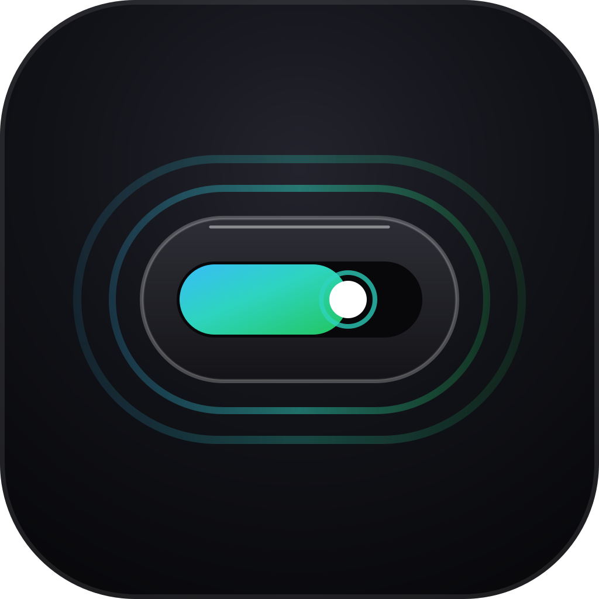

<div align="center">



# atoll

**Dynamic Island floating widget pinned to the top of your Windows desktop**

Zhipu GLM Coding Plan Quota Monitor · DeepSeek Wallet Balance Monitor · Minimalist Pomodoro Timer · Smart Clipboard History · Extensible Multi-Module Island Container

[](https://github.com/yak33/atoll/releases)
[](https://github.com/yak33/atoll/releases)
[](https://tauri.app/)
[](https://vuejs.org/)
[](LICENSE)

[English](./README_EN.md) &nbsp;|&nbsp; [简体中文](./README.md)

[🌐 Official Website](https://atoll-site-swart.vercel.app/) &nbsp;|&nbsp; [⬇️ Download Latest Release (v0.4.0)](https://github.com/yak33/atoll/releases/latest) &nbsp;|&nbsp; [📝 Release Notes](https://github.com/yak33/atoll/releases)

</div>

---

## 🌊 What is atoll?

> **Atoll**: A ring-shaped coral reef, island, or series of islets surrounding a central lagoon.  
> In our product vision, the core program serves as the serene and solid **reef base**, while each functional feature acts as a distinct **island** thriving upon it. As more modules arrive, a vibrant atoll ecosystem naturally emerges.

**atoll** is a modern, Apple-inspired "Dynamic Island" floating widget tailored specifically for Windows 10 & 11. Most of the time, it rests as a discreet 260 × 44px capsule pinned to the top edge of your primary screen:
- **Glanceable quota consumption**: Say goodbye to browser tabs just to check your API usage. Rolling consumption windows, countdowns, and quota alerts are always visible at a glance.
- **AI Agent activity at a glance**: Know whether ZCode / Claude Code / Antigravity / Qoder / Trae / DeepSeek Harness is working, waiting for your confirmation, or done — via the pill status dot and in-island bubble notices.
- **Strictly non-intrusive**: No taskbar footprint, zero focus stealing, millisecond-fast auto-hide during full-screen games/movies, and seamless drag-and-drop placement with persistent coordinates.

---

## ✨ Key Features

### 1. Zhipu GLM Coding Plan Real-time Monitor
- **Dual Rolling Windows**: Real-time tracking of both 5-hour and 7-day rolling usage percentages alongside reset countdowns.
- **Local Pure Clock**: Reset countdowns are calculated locally with high precision via an application clock, preventing unnecessary network spam.
- **24-Hour Sparkline Trends**: Automatically records snapshots locally on each poll. The expanded panel renders dual sparklines (emphasized 5h curve / subtle 7d curve) to visualize your burning trends.
- **Burn-Rate Forecast**: Evaluates the slope between consecutive poll samples to forecast "Depleted in approx. X hours at current rate", keeping you confident during coding sprints; smoothly hidden when samples are insufficient or invalid.
- **Three-Tier Status Alerts (Customizable thresholds)**:
  - 🟢 **Normal**: Emerald green highlight cursor with default surface background;
  - 🟡 **Caution** (Default ≥ 75%): Capsule turns warm amber, gently reminding you to pace usage;
  - 🔴 **Critical** (Default ≥ 90%): Soft pulsing red inner breathing glow (crafted to avoid hard window clipping);
  - 🔔 **Window Reset Alerts**: Native Windows Toast notification fires automatically whenever a usage window resets.
- **Universal Compatibility**: Supports both Personal and Team plans (configurable `organizationId` and `projectId`); handles Token limit and Credit limit billing modes seamlessly.

### 2. DeepSeek Wallet Balance Monitor (Optional Module)
- **Wallet balance at a glance**: Integrates DeepSeek's official `GET /user/balance` endpoint. The pill shows the total available balance; the expanded panel breaks it down into **topped-up balance** and **unexpired granted balance**, with each currency (CNY / USD) displayed independently and never mixed.
- **Trend & depletion forecast**: Samples every 10 minutes (random jitter + exponential backoff on failures) and renders a 24h balance sparkline in the panel; recharges or granted-credit arrivals reset the consumption baseline automatically instead of being misread as spending.
- **Tiered low-balance alerts**: Configurable thresholds (default amber ≤ ¥20 / red ≤ ¥5) tint both the pill and panel; upstream `is_available=false` (insufficient balance for further API calls) keeps it red.
- **Read-only & fully local**: Only a DeepSeek API Key is needed; balance queries are read-only and consume no tokens. The key is stored separately from the Zhipu credential.

### 3. AI Agent Activity Monitor (merged into the Usage module)
- **Pill Status Dot**: Whenever an agent is working / awaiting your confirmation / erroring, a status dot lights up at the right end of the usage pill — a cyan sonar ripple while working (spring pop on arrival plus a continuously expanding halo), amber bouncing while waiting, steady red on errors. Perceivable from the corner of your eye without interrupting your flow.
- **Panel Activity Strip**: The expanded panel lists every agent's live status (icon, name, state, last update) with waiting items pinned first; entries clean themselves up automatically by lifecycle (completed after 5 min, errors after 30 min) — no manual maintenance.
- **In-Island Bubble Notices**: When an agent starts working, awaits confirmation, or finishes a task, a bubble drops from beneath the pill — working bubbles stay pinned until the state changes (retracted upon waiting, completion, or stream loss), while completion and error notices linger for 30 seconds and others retract in ~15 seconds. Up to two bubbles display side by side (one per agent); the rest queue up. Hover to pause the countdown, click to jump straight to the details. Falls back to native Windows notifications whenever the island is hidden or edge-docked; the notification mode (bubble / system / both) is configurable in settings.
- **Bubble Micro-Theater**: Every bubble randomly draws one of 8 theme colors and one of 4 stickman animations (sprinting / typing / jumping / hammering), staying consistent for its whole lifetime; a theme-colored light band periodically sweeps across the capsule surface, and overlong text auto-scrolls marquee-style.
- **Companion Plugin Ecosystem**: The repo ships companion plugins for six hosts — ZCode, Claude Code, Antigravity, Qoder (including the Qoder CN domestic build), Trae (including the Trae CN domestic build), and DeepSeek Harness. Agents report their status through a loopback-only HTTP bridge (`127.0.0.1:41799`, machine-local, no CORS): ZCode uses a `process`-type hook invoking `curl.exe`, Claude Code uses a native `http`-type hook, Antigravity, Qoder and Trae go through their official hooks (`command`-type curl bridge), and DeepSeek Harness is a Cordis plugin doing in-process `fetch` — sidestepping Windows shell quoting entirely.
- **Broken-Stream Self-Healing**: If hooks die or an agent crashes, a "working" state older than 10 minutes degrades to "Unknown" instead of pretending to work forever; a stuck "waiting" state degrades after 60 minutes to prevent eternal pulsing.

### 4. Pomodoro Focus Timer
- **Sleep/Wake Immune State Machine**: Timestamp-based countdown calculations survive system sleep and hibernation without time drift or runaway countdowns.
- **Dual Phase Flow**: Automatic alternation between Focus and Break phases with Windows desktop toast alerts and subtle pulsing heartbeat animations while running.
- **Adjust on the Fly**: Slider controls for Work (5–60 min) and Break (1–30 min) durations, taking effect immediately upon the next phase transition.

### 5. Smart Clipboard History Module
- **Event-Driven Listening**: Utilizes Win32 `AddClipboardFormatListener` (via `clipboard-rs`) for zero-polling instant capture; supports plain text and images (screenshots/copied images automatically saved locally with thumbnail generation, hover full-size preview, and one-click write-back to system clipboard).
- **De-duplication & Pinning**: Duplicated copies refresh timestamps and move to the top without redundant records; holds up to 200 items with pinned items protected from eviction.
- **Instant Search & Write-back**: Substring keyword filtering with robust IME composition and focus protection; one-click write-back directly into Windows clipboard for effortless `Ctrl + V` pasting across apps.
- **100% Local & Private**: Never uploads or communicates with external servers; toggle recording off or purge history anytime in settings.

### 6. 6 Curated Skins & 11 Ambient Sheen Flows
- **6 Handcrafted Themes**: Obsidian (Emerald), Deep Sea (Cyber Ice Blue), Aurora (Midnight Violet), Flame (Sunset Orange), Mint (Fresh Pine), and Titanium (Matte Dark Gold), synchronized across pill capsules, highlights, and panels.
- **11 Ambient Sheen Effects**: Border Flow, Comet Tail, Dual Sheen, Particle Collider, Wave Ripple, Dual Wave, Sonar Pulse, Aurora Dispersion, Eclipse Gold, Diagonal Sweep, and Starlight Sparkle, bringing subtle life to your desktop.
- **Seamless Light/Dark Adaptation**: Full support for Light, Dark, or automatic synchronization with Windows system theme.
- **Flexible Module Management**: Show/hide and reorder modules right in settings — pill wheel cycling, panel tabs, and settings tabs all follow; at least one module stays visible, and future modules join automatically. 

### 7. Thoughtful, Non-Intrusive Desktop Experience
- **Fullscreen Auto-Hide**: Detects foreground fullscreen applications (games, video players, presentations) and hides instantaneously, restoring smoothly upon exit.
- **Top-Edge Auto-Docking**: When docked against the top screen edge and untouched for 3 seconds, folds automatically into an ultra-thin 3px neon ambient accent line; restores into full capsule on mouse hover (can be toggled in settings).
- **Screen Boundary Safety Net**: Never lose your window off-screen; dragging off-boundary automatically bounces back into full visibility on mouse release.
- **System Tray Quick Glance**:
  - Hover over the tray icon to check status instantly: `atoll · 5h: 24% | 7d: 45%` or `atoll · 🍅 Focus 22:15`;
  - Right-click tray menu provides Show/Hide, Hide Tray Icon (recoverable in Settings), About, and Exit.
- **Free Dragging & Coordinate Memory**: Grab and reposition both the capsule pill and expanded panel directly; positions are persisted and restored across reboots.
- **Silky Interactions & Spring Motion**: 
  - Hover (250ms by default, configurable 50–2000ms in settings) expands the panel with hover-intent protection against accidental swipes; clicking the pill expands instantly;
  - Wheel scrolling over top tabs or capsule cycles between functional modules;
  - Wheel scrolling inside clipboard history or preview cards seamlessly scrolls content without accidental module switching;
- **Tactile Sound Effects**: Synthesized crisp drop sounds via frontend Web Audio upon Pomodoro phase completion, window quota resets, and clipboard copies (zero external audio assets).

---

## 🖥️ Three-State Architecture

```
[ Pill 260×44 ] ──( Hover / Click to Expand )──> [ Expanded Panel ] ──( Top ⚙ )──> [ Settings Panel 340×700 ]
  5h [■■■□] 44% 2h15m                              Full Data + 24h Trend + Controls             Modular Settings
```

| State | Size (Logical px) | Purpose & Interaction |
| :--- | :--- | :--- |
| **Pill (Collapsed)** | `260 × 44` (Customizable width) | Stays pinned to screen top edge; displays most urgent quota window or Pomodoro countdown; mouse wheel cycles modules |
| **Expanded Panel** | Usage `400+ × 265` / Pomodoro `280 × 250` / Clipboard `320 × 380` / Balance `340 × 290` | Hover or click to expand; inspects full progress bars, sparklines, forecast, clipboard history & preview, or the DeepSeek balance breakdown; mouse wheel scrolls lists natively; top-right ⚙ opens settings |
| **Settings Panel** | `340 × 700` | Click to open settings; modular configuration for API Key, alert thresholds, Pomodoro durations, skins, sheens, and autostart |

---

## 🚀 Quick Start

### Method 1: Download Installer (Recommended)
1. Go to the [Releases Page](https://github.com/yak33/atoll/releases/latest) and download `atoll_0.4.0_x64-setup.exe`;
2. Double-click to install (installs to user local directory, **no administrator privileges required**);
3. Launch atoll, hover the top pill to expand, click the ⚙ (top-right) to open settings, then paste your Zhipu API Key under the Usage tab (enter Organization ID as well if using a Team plan). To monitor your DeepSeek balance, paste a DeepSeek Platform API Key under the Balance tab (kept separately from the Zhipu credential).

> 🔒 **Privacy Guarantee**: atoll is a client-only desktop application with zero backend. Your API Key and clipboard history are stored exclusively on your local machine in plaintext JSON. Besides direct requests to Zhipu's official quota endpoint and DeepSeek's official balance endpoint, no data is ever transmitted to any third-party server.

---

## 🛠️ Tech Stack & Directory Structure

```
atoll/
├── src/
│   ├── adapters/        # Data adapters: zhipu.ts (quota parser) / deepseek.ts (official balance parser, multi-currency wallet)
│   ├── core/            # Core logic (pure functions + unit tests)
│   │   ├── QuotaPoller.ts       # Polling scheduler: 5-minute interval + jitter + backoff
│   │   ├── pomodoro.ts          # Pomodoro state machine: timestamp-driven anti-drift
│   │   ├── usageHistory.ts      # 24h usage history: sampling, pruning & sparkline points
│   │   ├── burnRate.ts          # Burn rate estimation: adjacent snapshot slope calculation
│   │   ├── balance.ts           # DeepSeek balance: formatting, low-balance levels, trend & burn estimate
│   │   ├── BalancePoller.ts     # DeepSeek balance polling: 10-minute interval + jitter + backoff
│   │   ├── appSettings.ts       # Settings persistence: Tauri Store (skins, thresholds, etc.)
│   │   ├── theme.ts             # Theme & 6 skins engine, live system dark/light sync
│   │   ├── tray.ts              # System tray tooltip real-time status synchronization
│   │   ├── windowLayout.ts      # Window sizing, multi-state positioning & DPI scaling
│   │   ├── fullscreenWatch.ts   # Foreground window inspection for fullscreen auto-hide
│   │   ├── clipboardHistory.ts  # Clipboard history: de-duplication, pinning, LRU & search
│   │   ├── edgeDock.ts          # Top edge auto-docking & high-DPI coordinate calculations
│   │   └── sound.ts             # Offline tactile sounds: synthesized via Web Audio API
│   ├── composables/     # useGlowEffects (ambient sheen trigger) / nowTick (app clock)
│   ├── components/      # Modular Pill/Panel pairs + MiniIsland + ModuleTabs + SettingsPanel
│   ├── islandModules.ts # Module registry: mounts, wheel switching, dimensions & tabs
│   └── App.vue          # Three-state machine, CSS design tokens, sheens & module container
├── src-tauri/           # Rust shell: windowing, system tray, fullscreen watch, clipboard & autostart
└── site/                # Static marketing landing page hosted on Vercel (zero-build HTML/CSS/JS)
```

### Architectural Principles
- **Adapter Isolation**: All vendor-specific fields are strictly isolated within [adapters/zhipu.ts](src/adapters/zhipu.ts) backed by automated unit tests. The UI only consumes unified domain models.
- **Official Protocol Compliance**: Sends bare API Keys directly in compliance with Zhipu's authentication specs (without `Bearer` prefix). The DeepSeek balance endpoint instead uses the standard `Authorization: Bearer <API Key>`; the two credentials are stored separately.
- **Wallet Model Isolation**: Zhipu is a window-percentage model while DeepSeek is a wallet-balance model (total / topped-up / granted, multi-currency). Amounts stay as decimal strings from adapter to persistence, are only converted for trend/burn math, and currencies are never summed together.
- **Resource Efficiency**:
  - Polling interval fixed at 5 minutes + random jitter with 1→10 min exponential backoff;
  - Lightweight installer footprint at **~3.08 MiB**;
  - Idle memory consumption around **~138 MB** (mostly Windows WebView2 base runtime, Tauri core host is only ~30 MB);
  - **137 automated unit tests pass 100%**.

---

## 💻 Local Development & Build

### Prerequisites
- [Node.js](https://nodejs.org/) ≥ 20
- [Rust](https://www.rust-lang.org/) stable (tested on rustc 1.97.1+)
- Visual Studio Build Tools (with "Desktop development with C++" workload)
- Windows 10 / 11 (with built-in WebView2 runtime)

### Commands

```bash
# 1. Clone the repository
git clone https://github.com/yak33/atoll.git
cd atoll

# 2. Install frontend dependencies
npm install

# 3. Start local development (launches Vite dev server with Tauri floating window)
npm run tauri dev

# 4. Run automated test suites
npm test

# 5. Type-check and frontend production build
npm run build

# 6. Package Windows installer (output located in src-tauri/target/release/bundle/nsis/)
npm run tauri build
```

---

## 🧩 Extending New Modules

atoll adopts a **registry-driven, containerized modular architecture** (refer to the Pomodoro or Clipboard module as a blueprint):
1. Write pure state machine or business logic in `src/core/` (pure functions with comprehensive `.test.ts` test suites);
2. Create matched component pairs in `src/components/`: `XxxPill.vue` and `XxxPanel.vue`;
3. Register the module in `src/islandModules.ts` (define ID, title, components, and expanded size);
4. Wire props/events in `src/App.vue` (`pillProps` and `panelProps`);
5. Done! Module switching, tab navigation, and window resizing adapt automatically with zero container template modification.

---

## 📜 License

This project is licensed under the [MIT License](LICENSE).
