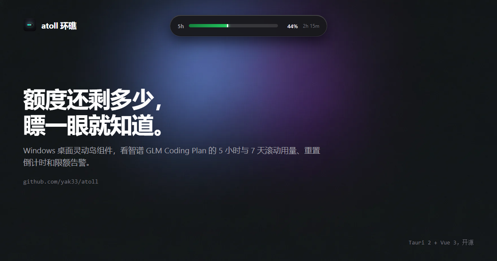

<div align="center">




# atoll

**A modern Dynamic Island floating widget pinned to the top of your Windows desktop**

Zhipu GLM Coding Plan Quota Monitor · DeepSeek Wallet Balance · Minimalist Pomodoro · Clipboard History · AI Agent Activity Hub

[](https://github.com/yak33/atoll/releases)
[](https://github.com/yak33/atoll/releases)
[](https://tauri.app/)
[](https://vuejs.org/)
[](https://github.com/yak33/atoll)
[](https://github.com/yak33/atoll/releases/latest)
[](LICENSE)

[🌐 Official Website](https://atoll-site-swart.vercel.app/) &nbsp;|&nbsp; [⬇️ Download Installer (v0.4.0)](https://github.com/yak33/atoll/releases/latest) &nbsp;|&nbsp; [📝 Release Notes](https://github.com/yak33/atoll/releases) &nbsp;|&nbsp; [简体中文文档](./README.md)

</div>

---

## 🌊 30 Seconds to Understand atoll

> **Atoll**: A ring-shaped coral reef, island, or series of islets surrounding a central lagoon.  
> The core container serves as the sturdy **reef platform**, while each functional feature acts as a distinct **island** thriving upon it. Freely plug, unplug, and arrange modules as your atoll comes to life.

**atoll** is crafted specifically for Windows 10 & 11. Most of the time, it rests as a discreet **260 × 44px** frosted-glass capsule pinned to the top edge of your screen, delivering an effortless, glanceable experience:

- 👁️ **Glanceable quota consumption**: No more opening browser tabs to check remaining quota. Dual 5h / 7d rolling windows, depletion curves, and breathing alert halos stay right in your peripheral vision.
- 🤖 **Real-time AI Agent tracking**: Know instantly whether ZCode, Claude Code, Antigravity, Qoder, or Trae is working, awaiting confirmation, or completed — through status ripples and in-island drop bubbles.
- 🫥 **Strictly non-intrusive**: No focus stealing, zero taskbar clutter, **millisecond auto-hide** during full-screen games & movies, and folds into a **3px neon hairline** when parked idle at the top edge.
- 🪶 **Green & native efficiency**: Built on **Tauri 2 + Vue 3**, the installer is merely **~3.08 MiB**, with core Tauri memory footprint at only **~30 MB**, strictly zero third-party telemetry.

---

## 🧩 Core Feature Matrix

atoll features a **multi-module container architecture**. All modules can be customized, toggled, and reordered in Settings, and cycled smoothly via mouse wheel scrolling in the collapsed pill state.

| Module | Core Capabilities | Collapsed Pill Preview | Expanded Panel Features |
| :--- | :--- | :--- | :--- |
| **🧠 Zhipu GLM Quota** | • Dual 5h & 7d rolling usage window %<br>• Local pure clock reset countdown<br>• Personal & Team plan support (Token / Credit) | Tightest window progress bar<br>+ Percentage + Countdown<br>+ Agent status dot | • 24h dual-line Sparkline trend graph<br>• Burn-rate estimation (hours until depletion)<br>• Three-tier breathing alert (Green/Amber/Red)<br>• Windows Toast on quota reset |
| **🐋 DeepSeek Balance** | • Integrates official `GET /user/balance`<br>• Multi-currency (CNY / USD) split display<br>• Pure read-only querying, zero token consumption | Available balance total<br>+ Currency symbol<br>+ Low-balance color alerts | • Breakdown of topped-up vs. grant balance<br>• 24h consumption trend & depletion forecast<br>• Auto baseline recalibration on top-ups<br>• 10min jittered anti-abuse polling |
| **🤖 AI Agent Hub**<br>*(integrated in Usage)* | • Real-time telemetry across 6 IDE hosts<br>• Priority: Waiting > Working > Error<br>• 10-minute timeout auto-healing | Cyan sonar ripple (Working)<br>Amber bouncing (Waiting)<br>Steady red (Error) | • Top active Agent list (auto-cleans in 5m)<br>• Drop-down streamlight bubble notifications<br>• Hover-to-pause & queue management<br>• Seamless fallback to Windows native toasts |
| **🍅 Minimalist Pomodoro** | • Flexible focus (5~60m) & break intervals<br>• Timestamp-driven, sleep-safe timing<br>• Subtle heartbeat breathing glow | Stage icon 🍅<br>+ Time remaining countdown<br>+ Rhythmic indicator dot | • Start / Pause / Reset controls<br>• Stage transition desktop toast alerts<br>• Pure Web Audio synthesised droplet chimes |
| **📋 Smart Clipboard** | • Win32 native event-driven, zero polling<br>• Automatic text & image snippet capture<br>• Pure local storage, strictly private | Total collected items count<br>+ Clipboard status icon | • Instant substring search with highlights<br>• Image thumbnail hover preview<br>• Deduplication with auto-bump to top<br>• One-click copy back & pin protection |

---

## 🎨 Visual Craft & Interaction Philosophy

<div align="center">

```
  [ Collapsed Pill (260×44) ] ──────( Mouse Scroll )──────> Smooth Module Switching (Usage / Balance / Pomodoro / Clipboard)
             │
             ├──( Hover / Click )──────> [ Expanded Panel (280~400 × 265~380) ]
             │                                   │ (Click top-right ⚙)
             │                                   ▼
             └──( Idle at top edge 3s )──> [ Settings Panel (340 × 700) ]
                  [ 3px Neon Streamline Mode ]
```

</div>

- **Seamless Three-State Morphing**: Compact pill pinned to top, expands smoothly on hover or click, opens modular configurations on settings tap.
- **6 Hand-Crafted Texture Skins**: Obsidian (Classic Emerald), Deep Sea (Tech Cyan), Aurora (Midnight Purple), Blaze (Sunset Orange), Mint (Crisp Forest), and Titanium Gold (Matte Black Titanium).
- **11 Physics-Inspired Optical Flow FX**: Border flow, comet trail, particle collision, sonar ripple, eclipse rim, and more — creating a subtle, breathing desktop presence.
- **Auto-Fold into 3px Neon Line**: Pinned against the top edge for 3 seconds of inactivity, atoll gracefully folds into an ultra-thin 3px glowing accent line; hover to instantly revive.
- **Smart Full-Screen Evasion**: Real-time Win32 foreground window detection automatically hides the island within milliseconds during full-screen games, PPT presentations, or video playback.
- **Bounce-Back Boundary Physics**: No matter how vigorously dragged, releasing the window springs it back inside visible screen boundaries, with full multi-monitor high-DPI awareness.

---

## 🔌 AI Agent Companion Bridges

atoll runs a dedicated local bridge service on loopback address `127.0.0.1:41799` (local access only, zero CORS exposure), receiving live session hooks from various AI assistants:

| Host IDE / Tool | Bridge Plugin Path | Mechanism & Characteristics | Installation & Setup |
| :--- | :--- | :--- | :--- |
| **ZCode** | `plugins/zcode-bridge` | Process-type hook invoking local `curl.exe` | Settings → Plugins → Add from local folder `plugins/` |
| **Claude Code** | `plugins/claude-bridge` | Native host HTTP hooks, zero shell dependencies | `/plugin marketplace add <path>/plugins`<br>`/plugin install atoll-claude-bridge@atoll-bridges` |
| **Google Antigravity** | `plugins/antigravity-bridge` | Official hooks safely calling bridge endpoints | Append hook configuration into `~/.gemini/config/hooks.json` |
| **Qoder** (incl. Qoder CN) | `plugins/qoder-bridge` | Official hooks accurately catching tool confirmation | Run in repo root: `node scripts/install-qoder-bridge.mjs`, restart IDE |
| **Trae** (incl. Trae CN) | `plugins/trae-bridge` | Global hooks wired to Notification events | Run in repo root: `node scripts/install-trae-bridge.mjs`, restart IDE |
| **DeepSeek Harness** | `plugins/deepseek-bridge` | Cordis bundle plugin with in-process `fetch` | `dsh plugin --profile desktop add file:<path>/plugins/deepseek-bridge` |

> For comprehensive integration guides and troubleshooting, see [plugins/README.md](plugins/README.md).

---

## 🚀 Quick Start

### Method 1: Download Windows Installer (Recommended)

1. Head over to the [Releases page](https://github.com/yak33/atoll/releases/latest) and download `atoll_0.4.0_x64-setup.exe`;
2. Double-click to install (installs to user local directory, **no admin privileges required**);
3. Hover over the pill to expand, click ⚙ at the top right to open Settings:
   - In the "Usage" tab, paste your Zhipu API Key (plus Org/Project IDs if using Team Plan);
   - In the "Balance" tab, paste your DeepSeek API Key (stored separately from Zhipu credentials).

> 🔒 **Privacy & Security Commitment**: atoll is an open-source, **zero-backend, zero-telemetry** desktop utility. API credentials are stored strictly on your local machine in plain JSON. Aside from making direct read-only queries to official Zhipu and DeepSeek quota endpoints, no data is ever transmitted to any third party.

---

### Method 2: Build & Run from Source

#### Prerequisites
- [Node.js](https://nodejs.org/) ≥ 20
- [Rust](https://www.rust-lang.org/) stable (rustc ≥ 1.80 recommended)
- Visual Studio Build Tools (with "Desktop development with C++" workload)
- Windows 10 / 11 (includes WebView2 runtime)

#### Build Commands

```bash
# 1. Clone repository
git clone https://github.com/yak33/atoll.git
cd atoll

# 2. Install frontend dependencies
npm install

# 3. Launch dev environment (starts Vite server and transparent Tauri window)
npm run tauri dev

# 4. Run automated test suite (137 tests passing)
npm test

# 5. Build production Windows installer (output in src-tauri/target/release/bundle/nsis/)
npm run tauri build
```

---

## 🏗️ Architecture & Extensibility

atoll follows a decoupled architecture of **"Pure Functional Core + Registry-Driven Container + Native OS Shell"**:

```
atoll/
├── src/
│   ├── adapters/        # Data adapters: zhipu.ts (quota parsing) / deepseek.ts (balance parsing)
│   ├── core/            # Domain logic (100% pure functions + corresponding .test.ts)
│   │   ├── QuotaPoller.ts       # Zhipu poller (5m + random jitter + exponential backoff)
│   │   ├── BalancePoller.ts     # DeepSeek poller (10m + backoff)
│   │   ├── agentHub.ts          # Agent state machine (arbitration, heartbeat, cleanups)
│   │   ├── notifyQueue.ts       # In-island drop-down notification queue
│   │   ├── pomodoro.ts          # Pomodoro state machine (timestamp anti-drift)
│   │   ├── clipboardHistory.ts  # Clipboard history (deduplication, ordering, search)
│   │   ├── moduleLayout.ts      # Module layout management (visibility & custom sorting)
│   │   └── theme.ts / sound.ts  # Skin/theme synchronization & Web Audio chimes
│   ├── components/      # View layer: paired XxxPill.vue (collapsed) & XxxPanel.vue (expanded)
│   ├── islandModules.ts # Module registry (registration, dimensions, configs)
│   └── App.vue          # Three-state machine, drag boundary physics, lighting container
├── src-tauri/           # Rust shell: click-through / tray / fullscreen watch / clipboard / HTTP bridge
├── plugins/             # Companion Agent bridge marketplace (ZCode / Claude / Qoder / Trae / DSH)
└── site/                # Official static landing page (zero build HTML/CSS/JS)
```

### 🧩 5 Steps to Extend a New Module

Adding new modules follows a clean, standardized plugin workflow (e.g. refer to `pomodoro`):
1. **Implement Core Logic**: Create pure functions / state machine in `src/core/` and write `.test.ts` unit tests;
2. **Build Component Pair**: Create `XxxPill.vue` (collapsed pill) and `XxxPanel.vue` (expanded panel) under `src/components/`;
3. **Register Module**: Add entry to `src/islandModules.ts` with module ID, title, components, and panel size;
4. **Wire Props**: Pass domain state in `pillProps` / `panelProps` inside `src/App.vue`;
5. **Done!** Scroll wheel switching, expansion animations, edge dock, and settings reordering work automatically.

---

## 📜 License

This project is licensed under the [MIT License](LICENSE). Contributions, issues, and new module PRs are warmly welcomed!
